# Pi Agent 安装与基础使用指导

## 本次完成的六项任务

1. 本地安装并启动 Pi，提交安装成功截图。

2. 任选一种方式配置模型，完成最简单的一次会话并截图。

3. 切换模型和模型思考级别，记录切换前后状态并截图。

4. 使用 @ 引用代码文件，并粘贴一张小图片完成测试，各自截图。

5. 从 Pi Packages（https://pi.dev/packages） 自选插件，用命令安装，再单独运行 pi，提交加载与试用截图。

6. 让 AI 安装 PPT Skill 到某一项目文件夹内，提交目录结构、启动发现与调用截图。（可选）

**提交方式：**上传到个人 Git 仓库内，以 Issue 的形式发起作业地址。Issue 名称：`实践课1： Pi Agent安装与使用 [姓名拼音]`。

本次安装的是 Pi 客户端，不是把大模型权重部署到电脑。后续源码分析需另行获取 GitHub 仓库；本次不要求编译整个仓库。

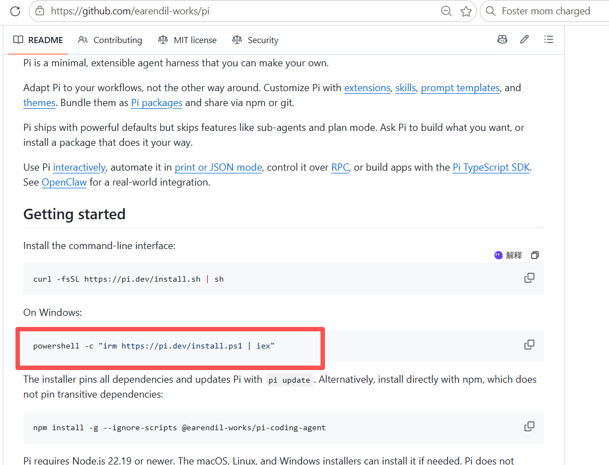

*图1 官方 README 中的安装入口*

## 任务一 本地安装并启动

1. 打开项目官方仓库，确认安装命令来源。Windows 在 PowerShell 中执行：

```powershell
powershell -c "irm https://pi.dev/install.ps1 | iex"
```

2. 按安装器实际提示确认安装。若提示缺少 Node.js 或 Git，按引导完成；不要把截图中的个人路径作为自己的路径。

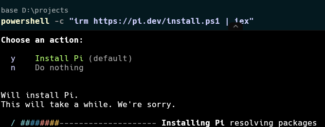

*图2 在 PowerShell 中运行安装器*

3. 安装完成后关闭旧终端，重新打开。在一个专用练习文件夹中启动：

```powershell
mkdir pi-test   # 或者其他文件夹名称
cd pi-test
pi
```

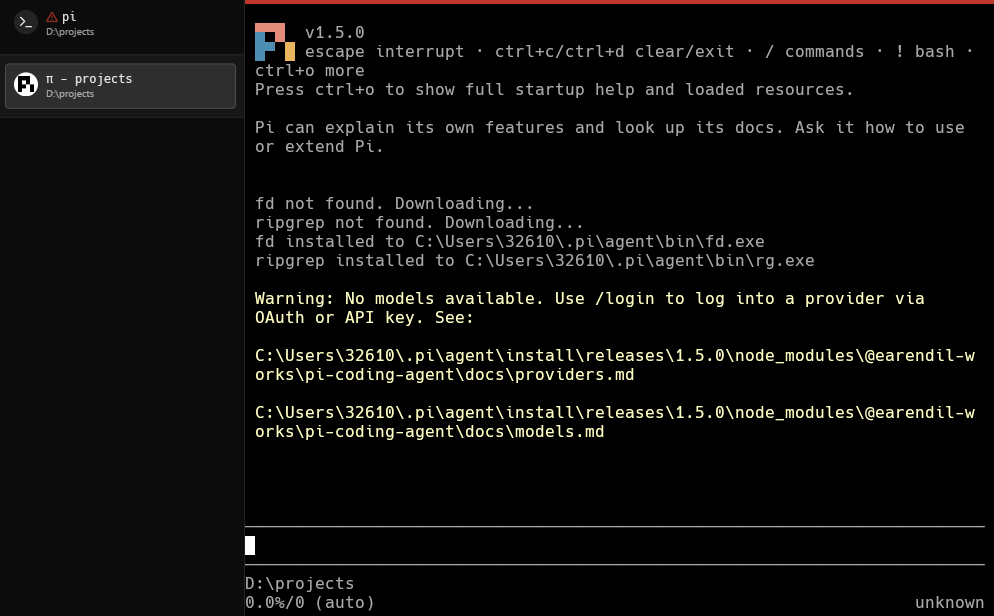

*图3 Pi 已启动但尚未配置模型*

截图要求 S1：显示 Pi 已成功启动、版本信息和当前工作目录。只有下载进度不能证明安装完成。出现“No models available”表示客户端已启动，下一步需要配置模型。

macOS / Linux 可从官方 README 获取对应安装命令。已配置 Node.js 的同学也可使用官方 npm 安装方式，任选一种，无需重复安装。

## 任务二 配置模型并完成一次会话

任选 API Key 或账户登录一种方式。以下以 API Key 为主线，账户登录见下文。网页聊天账户与 API 调用额度可能分开管理，请先确认账户可用。

1. 进入模型提供商的官方 API 平台。DeepSeek 示例入口如下。

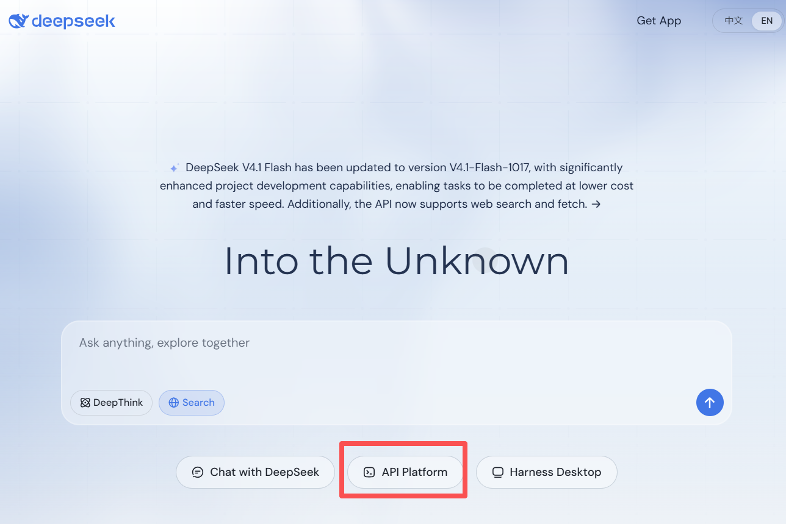

*图4 从 DeepSeek 官网进入 API Platform*

2. 在 API keys 页面创建自己的密钥。

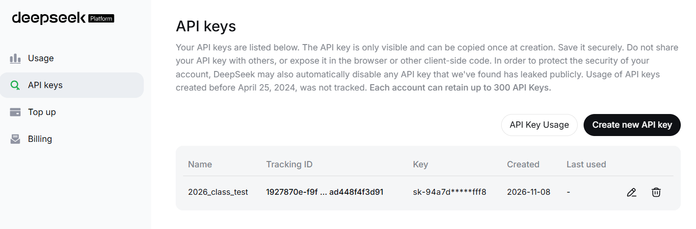

*图5 API keys 页面示例*

3. 回到 Pi，输入 /login，选择 Sign in with an API key，再搜索并选择提供商。模型名称以当前列表为准，无需照抄示例型号。

截图不要求展示密钥创建过程；验收重点是配置成功后能收到模型回复。

## 任务二 登录操作与会话验收

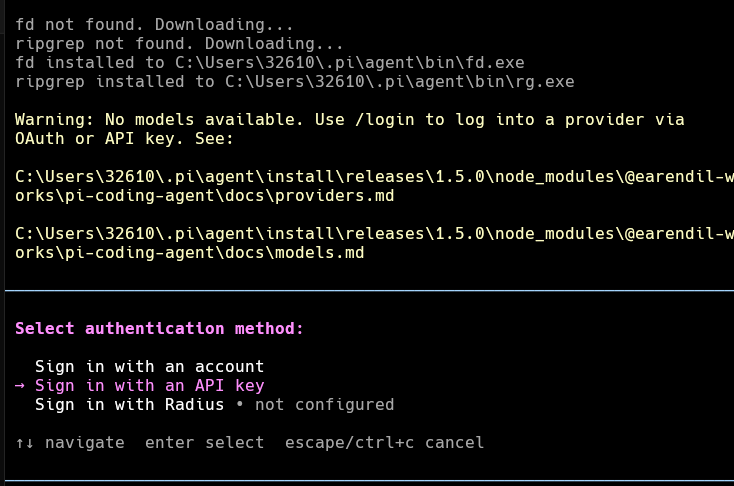

*图6 在 /login 中选择 API Key 登录*

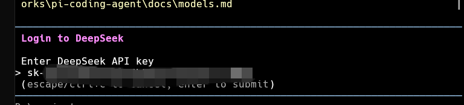

*图7 输入密钥后提交（示例已遮挡）*

配置完成后发送：你好。 （其他的任何prompt均可）

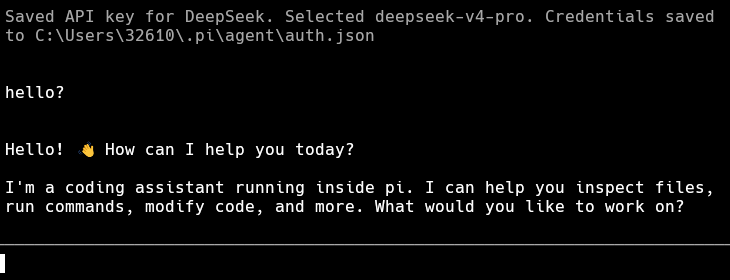

*图8 配置成功后完成最简单的一次会话*

另一种方式：在 /login 选择 Sign in with an account，按界面选择可用提供商并完成浏览器授权。可用范围取决于账户和提供商支持，不要求所有同学使用同一种账户。

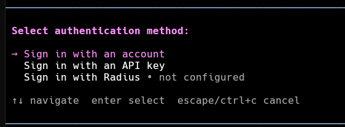

*图9 账户登录入口（与 API Key 方式二选一）*

截图要求 S2：包含自己发出的提示词、模型实际回复和当前模型信息。不要提交 auth.json、授权回调链接或完整密钥。

## 任务三 切换模型与模型思考级别

1. 输入 /model，或按 Ctrl+L 打开模型选择器。记录当前模型，再选择另一个可用模型并确认。列表只出现一个模型时，先配置另一个可用模型或提供商。

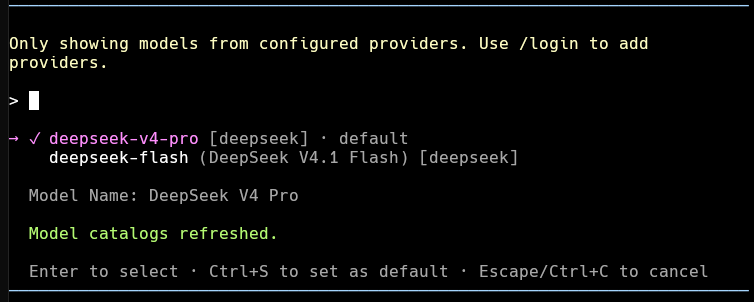

*图10 模型选择器示例*

2. 切换后发送一个短问题，例如“请用一句话解释持续集成”，确认仍可正常会话。记录切换前后的模型名称，不以打开选择器代替完成切换。

3. 输入 /thinking 选择思考级别，或按 Shift+Tab 循环切换当前模型支持的级别。记录切换前后状态。若快捷键无效，使用命令或 /hotkeys 查看当前绑定。

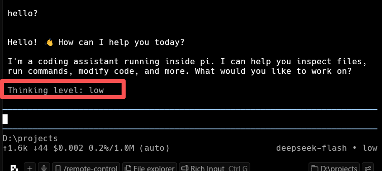

*图11 思考级别和底部模型状态*

截图要求 S3：显示模型切换前后名称及思考级别切换前后状态，可用两张截图组合证明。说明各选择了什么，以及任务复杂度如何影响选择。

思考级别是模型推理设置，不是更换模型，也不是显示或隐藏思考文本。部分模型不支持调整；应换用支持该设置的模型完成练习。较高思考级别不保证每次答案更好，可能增加等待时间和用量。

## 任务四 引用代码并粘贴小图片

### A 使用 @ 引用代码文件

在 pi-test 文件夹创建 hello.py，保存以下内容：

```python
def add(a, b):
    return a + b

print(add(2, 3))
```

在该文件夹启动 Pi。输入 @，在候选列表中选择 hello.py（也可继续输入文件名筛选），再输入提示词并发送：

“请解释 @hello.py 的功能，说明运行后输出什么。只解释，不修改文件。”

检查回复是否解释了 add 函数并给出输出 5。@ 用于选择并引用文件；只打出 @ 而未选中文件，不算完成引用。

截图要求 S4：显示引用的文件名、问题和实际回复；若回复区域太长，可用两张截图。

### B 粘贴小图片并测试

准备一张约 200×200 像素的小图片，例如用画图画一个蓝色方块，旁边写数字 7。先截取图片内容到剪贴板，不要只复制图片文件的路径。

切换到明确支持图片输入的模型。在 Pi 输入区按 Windows 的 Alt+V 粘贴；当前版本也可能支持 Ctrl+V。macOS 通常使用 Ctrl+V，以 /hotkeys 为准。确认出现图片附件或图片输入提示，再发送：

“请描述图片中的颜色、形状和数字。”

截图要求 S5：显示已附加图片的提示、问题和实际回复；报告同时插入原始小图片，便于核对识别结果。无需测试大图或批量图片。

如果 Alt+V 无反应：确认剪贴板里是图像，检查终端快捷键冲突，使用 /hotkeys 核对绑定；兼容终端也可尝试拖入图片作为排查，但本任务仍需记录图片粘贴操作。

## 任务五 安装并使用一个插件

插件（Extension）能增加工具、命令、界面或事件处理；Skill 则提供特定任务的操作说明及支持文件。Pi Package 可以包含两者，也可以包含主题和提示模板。安装包不代表其中所有资源都已加载。

1. 打开 https://pi.dev/packages，自选一个插件，阅读其 npm 或仓库说明，记录名称、来源、安装命令、作用和所需配置。不局限于视频里的插件。

2. 在 PowerShell 中执行目录给出的安装命令。例如：

```powershell
pi install npm:pi-web-access
```

该命令是个人级安装。若只希望当前项目使用，先进入项目目录，执行 pi install npm:插件包名 -l；需要信任当前项目时，阅读提示后确认。已理解并信任项目内容时可使用：

```powershell
cd D:\projects\study
pi install npm:pi-web-access -l --approve
```

3. 安装完成后退出原 Pi 会话，再在终端单独输入 pi 重新启动。截图须包含启动后的 [Extensions] 区域和插件名称。也可用 pi list 辅助核对包来源，不能仅用安装命令截图代替加载成功。

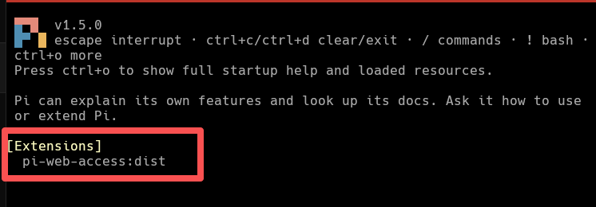

*图12 用户提供的重启 Pi 后已加载 pi-web-access 示例*

4. 根据所选插件说明试用一个最小功能。例如 pi-web-access 可尝试“请获取 https://example.com 的页面标题”，观察对应工具调用及结果；若提示需要配置，按该插件 README 处理。加载成功与联网功能可用应分别记录。

截图要求 S6：安装成功输出、重新运行 pi 后的加载信息，以及一次插件功能调用结果。任选插件，报告说明实际选用的功能。

常见问题：pi install 依赖 npm；若提示找不到 npm，安装或修复 Node.js/npm，并重新打开终端。Pi 已能运行，不代表当前 PowerShell 的 npm 命令也可用。

## 任务六 让 AI 安装一个 PPT Skill（选做项）

示例采用 anthropics/skills 仓库的 skills/pptx，包含 PPT 创建、读取、编辑及检查说明。本机已由 Pi 读取并执行下载脚本，下载到 D:\\projects\\study\\.pi\\skills\\pptx，(同学的下载路径可自行选择，此处为教师演示)，共 56 个文件。源 commit：2c5958ecac7cee2b583967a2c4981d0f4a75c579。

1. 在 D:\\projects\\study 打开终端并启动 pi。向 AI 发送以下提示词：

“请从 https://github.com/anthropics/skills 下载 skills/pptx 完整目录，安装到当前项目的 .pi/skills/pptx。保留 SKILL.md、LICENSE.txt 和 scripts 等支持文件，记录源 commit。只安装这个 Skill，不修改其他项目，不自动安装依赖；如目标已存在先说明情况。完成后列出目录结构。”

下载整个 Skill 目录，不要只复制 SKILL.md。让 AI 展示执行结果，并检查目标路径。不要把 Skill 当作 npm 插件执行 pi install npm:pptx。

2. 检查目录结构。Pi 从项目 .pi/skills 等位置发现技能；把文件随便放在 study/pptx 不一定会自动加载。

```text
D:\projects\study\
  .pi\
    skills\
      pptx\
        SKILL.md
        LICENSE.txt
        scripts\
          thumbnail.py
          add_slide.py
          clean.py
          office\ ...
```

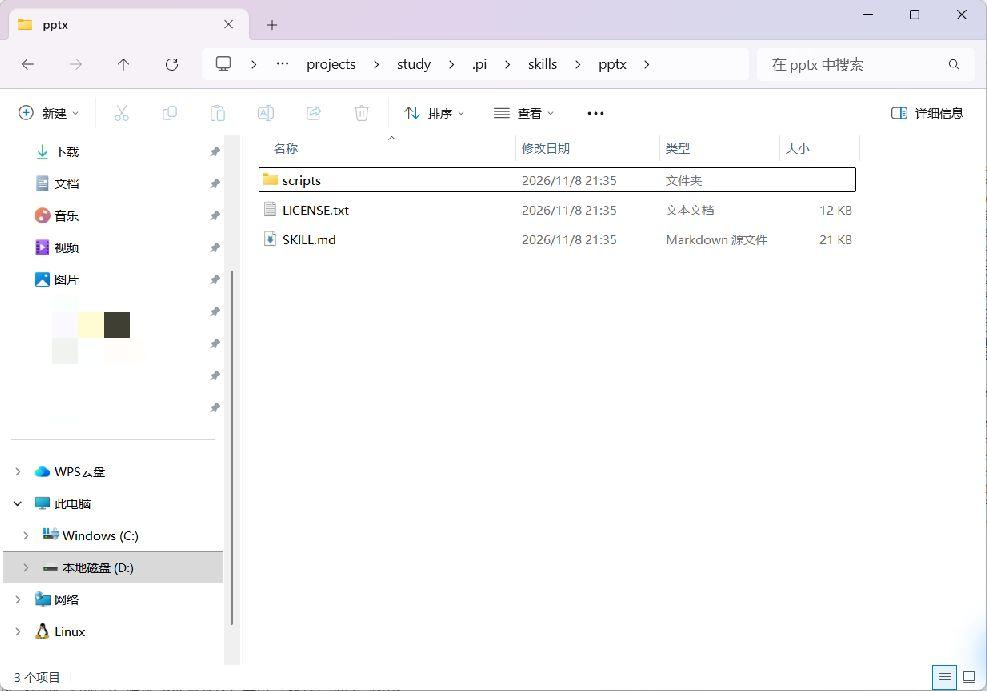

*图13 本机实际 Skill 文件夹截图*

截图要求 S7：地址栏或终端路径可辨认，展示 SKILL.md、许可证和 scripts；必要时补一张 scripts 内部截图。

## 任务六 启动发现与实际调用

3. 完全退出原会话，回到终端，在 study 目录中再次输入 pi：

```powershell
cd D:\projects\study
pi
```

按需使用 Ctrl+O 查看启动帮助和已加载资源，检查 [Skills] 或资源列表中的 pptx。新安装后也可在当前会话 /reload，但本次要求额外截图证明重新启动后的发现结果。

4. 输入显式调用命令，完成最小验证：

```text
/skill:pptx 请说明这个 Skill 的名称、用途和所在目录，
```

截图要求 S8：从 study 启动 Pi 后显示 pptx 已发现，并展示 /skill:pptx 的调用及回复；路径必须指向本次安装位置。仅有 AI 声称“装好了”不算验收通过。

安装成功、发现成功、调用成功、生成 PPT 成功是四个层次。本练习前三项必做；选做生成一个两页 PPT，并核查文件能打开。Skill 文本可能假设某些工具预装，不能直接当成本机事实；先检查 Node.js/pptxgenjs、Python 和所需转换工具，再按实际任务补齐依赖。

### 参考入口

项目与安装说明：https://github.com/earendil-works/pi
