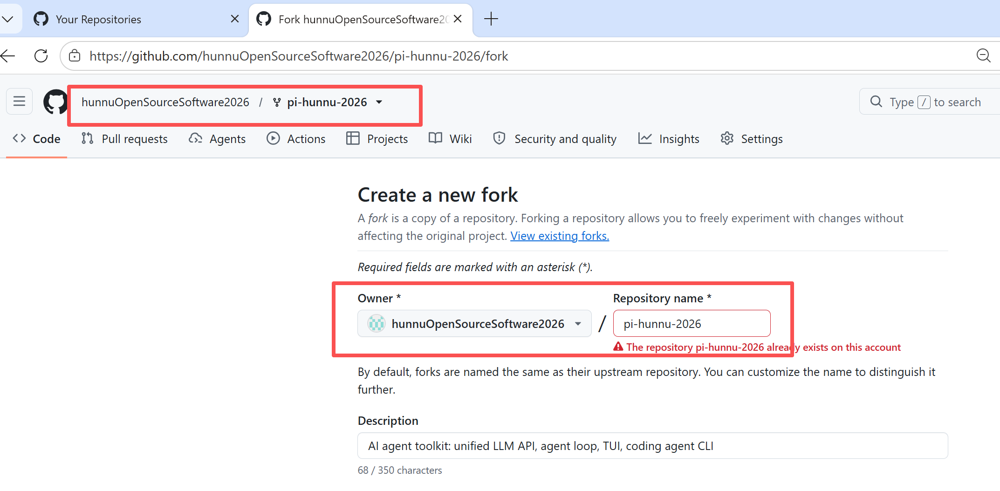

# 小组组织建仓与 Pi Agent 源码阅读

本次作业以已建立的小组 Organization 为单位，由组长建立小组代码仓库，每位成员下载源码并分析构建涉及的模块，为后续团队开发做准备。

## 任务一：组长将课程仓库 fork 到小组组织

由组长打开 [课程仓库的 Fork 页面](https://github.com/hunnuOpenSourceSoftware2026/pi-hunnu-2026/fork)，完成以下工作：

1. 在 **Owner** 中选择本小组已经建立的 Organization。
2. 仓库名称建议保留 `pi-hunnu-2026`，创建小组 fork。
3. 确认仓库属于小组组织，并将仓库地址发给所有成员。
4. 确认组员已加入小组组织，并具有后续开发所需的仓库访问权限。



**注意：截图是操作位置示意，不是创建成功的结果。** 图中的 Owner 仍是教师组织 `hunnuOpenSourceSoftware2026`，因此出现了同名仓库已存在的提示。学生应改选自己的小组组织，不要照抄截图中的 Owner，也不要将团队仓库放在组长个人账号下。若小组已经完成 fork，核对现有仓库后直接使用即可。


## 任务二 下载课程仓库源码

### 1. 建立实验目录并下载源码

尽量在全英文路径下下载项目。每位成员（包括组长）从本小组组织内的仓库下载源码，执行前将下面的 URL 替换为自己小组的仓库地址：

```powershell
git clone --branch main https://github.com/hunnuOpenSourceSoftware2026/pi-hunnu-2026.git # 替换成自己小组组织内的仓库
cd pi-hunnu-2026
```

如果小组修改了仓库名称，`cd` 后的文件夹名称也应相应修改。

如果目标文件夹已经存在，不要直接删除或覆盖。可以选用另一个空目录，或确认已有目录确实是本次所需仓库后继续。

### 2. 确认源码来源和版本

```powershell
Get-Location
git remote -v
git branch --show-current
git rev-parse HEAD
git status --short
```

检查 `origin` 是否指向**自己小组组织内的仓库**，当前分支是否为 `main`，并把完整提交编号记录到报告中。后续所有安装和构建命令，除特别说明外，都在这个仓库根目录执行。

**截图要求 S1：** 显示当前目录、远端地址、分支和提交编号。仅打开 GitHub 网页不能证明源码已下载到本地。

## 任务三：分析子模块功能与依赖关系

结合各模块的说明文档、`package.json` 和源码，自行分析构建涉及的以下文件夹；若本人版本有增减，以实际代码为准并说明差异。

| 子文件夹 | 代码主要实现什么功能 | 本模块 build 执行什么、生成什么 | 直接依赖哪些内部模块 | 依据文件或代码位置 |
|---|---|---|---|---|
| `telemetry` | 待分析 | 待分析 | 待分析 | 待填写 |
| `schema` | 待分析 | 待分析 | 待分析 | 待填写 |
| `chord` | 待分析 | 待分析 | 待分析 | 待填写 |
| `tui` | 待分析 | 待分析 | 待分析 | 待填写 |
| `codemode` | 待分析 | 待分析 | 待分析 | 待填写 |
| `mcp` | 待分析 | 待分析 | 待分析 | 待填写 |
| `ai` | 待分析 | 待分析 | 待分析 | 待填写 |
| `durable` | 待分析 | 待分析 | 待分析 | 待填写 |
| `env` | 待分析 | 待分析 | 待分析 | 待填写 |
| `agent` | 待分析 | 待分析 | 待分析 | 待填写 |
| `coding-agent` | 待分析 | 待分析 | 待分析 | 待填写 |

使用 **Mermaid 或 draw.io 或 Power Point等** 绘制一张模块层级与依赖关系图，图中包含上述模块，统一采用“使用方 → 被依赖方”的箭头方向，并说明层级划分依据。图中展示有依据的直接依赖；如包含开发依赖或可选依赖，应明确区分。提交可阅读的图及可编辑图源。

结合分析回答：

1. 根目录与子模块中的 `npm run build` 分别读取什么配置、执行什么工作？
2. 构建顺序和模块依赖有什么关系？相邻构建的模块是否一定互相依赖？
3. 选择一条涉及至少三个模块的依赖路径，说明这些模块如何分工。

可以小组讨论和分工阅读，但每人须用自己的语言整理完整报告，标明本人重点分析的模块。不能只复制包的名称、简介或未经核实的 AI 回答。

## 作业提交

每位成员提交一份 Markdown 报告，包含：

- **源码获取：** 提供的组织仓库截图、本人 clone 后的仓库信息和源码目录截图, 并在issue中以文本（URL）形式贴出实际clone地址。
- **模块分析：** 构建顺序、模块分析表、依赖关系图及图源、三个问题的回答。

报告和图片放入个人作业仓库，在课程作业仓库提交 Issue：

`实践课2：组织建仓与源码分析 [姓名拼音]`

Issue 正文提供个人报告链接和小组代码仓库链接。**个人作业仓库用于提交报告，小组组织仓库用于后续共同开发。** 提交前检查图片和关系图能否正常显示。
