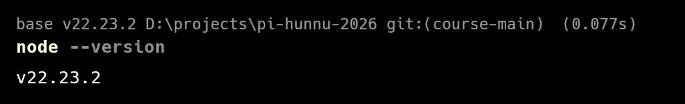
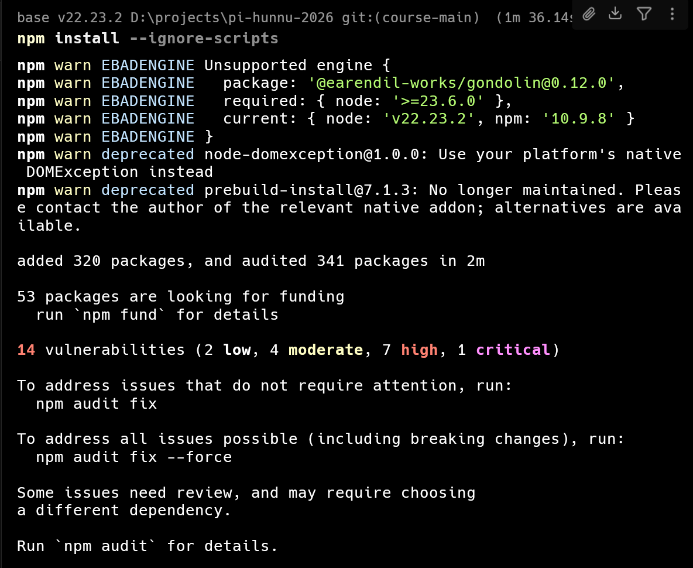
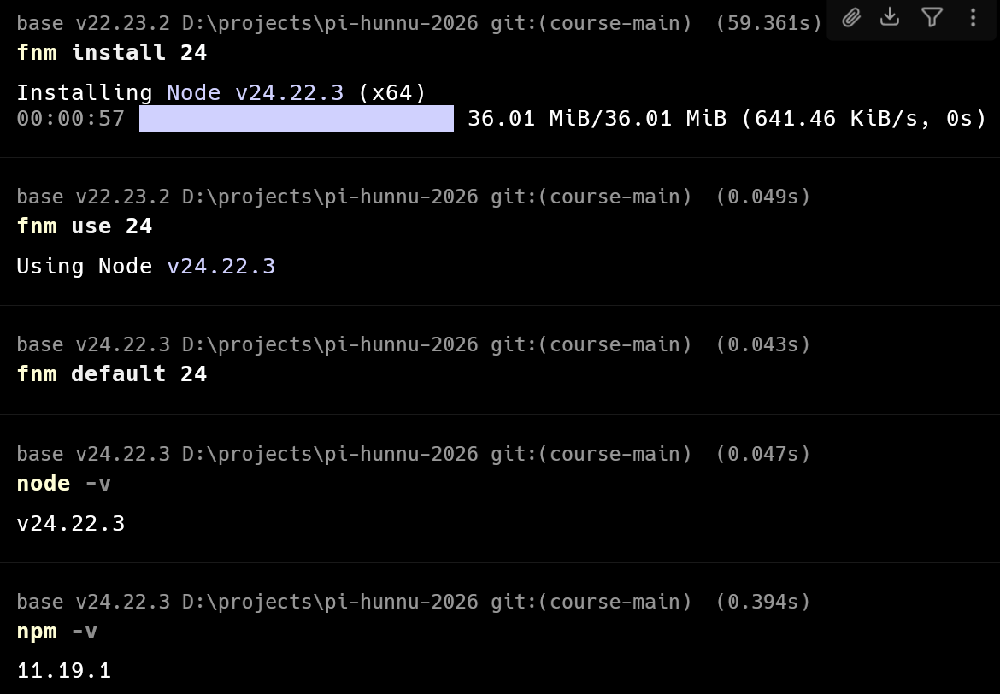
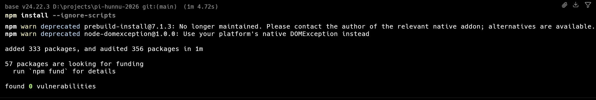
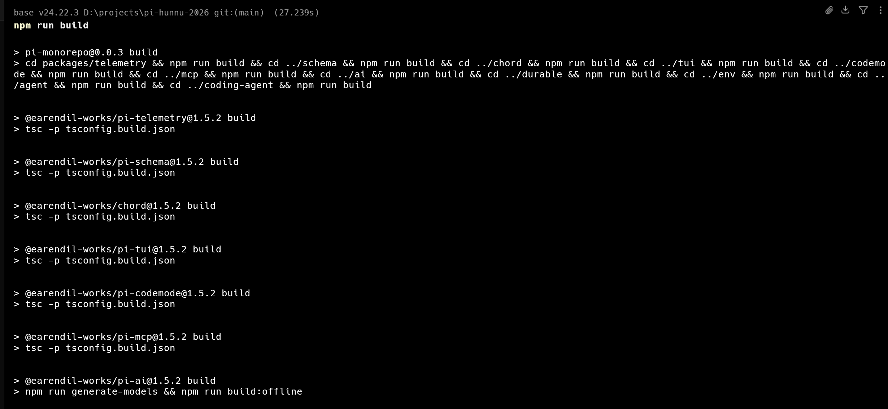

# Pi Agent 源码获取、依赖安装与本地编译指导

## 本次完成的六项任务

1. 检查并准备 Node.js、npm 和 Git，记录实际版本并截图。
2. （这儿实际上是第二次作业就做了的）下载课程仓库源码，并截图。
3. 在仓库根目录安装依赖，说明安装命令的作用并截图。
4. 完成本地编译，检查构建产物并验证其能够运行，并截图。
5. 记录下所遇到的困难，以及解决过程，描述并截图（重点）


第一次实践课侧重安装和使用 Pi 客户端，本次侧重建立本地源码开发环境。完成后，应能够说明“源码在哪里、依赖装在哪里、构建执行了什么、正在运行哪个版本”。本次不要求构建独立 EXE，也不要求部署大模型权重。


**仓库与版本：** 使用第二次实践作业，各小组组织内fork的仓库地址。


## 任务一 实验准备：检查和安装开发工具

### 1. 检查现有环境

打开 PowerShell，逐条执行：

```powershell
node --version
npm --version
git --version
```

三条命令分别检查 Node.js、npm 和 Git。第一次实践中 `pi` 能运行，不代表当前终端一定能找到这三个工具。
**截图要求 S1：** 显示当前环境依赖的各个版本。

| 工具 | 本次用途 | 要求或建议 |
|---|---|---|
| Node.js | 运行 JavaScript 程序和项目开发脚本 | 根项目声明 `>=22.19.0`；本次实验建议使用 Node.js 24 LTS |
| npm | 安装依赖、执行项目脚本 | 使用所安装 Node.js 附带的 npm，记录实际版本 |
| Git for Windows | 下载和管理源码，并提供 Git Bash | 安装后能执行 `git --version` |
| 文本编辑器 | 查看和编辑源码 | 可使用 VS Code 或自己熟悉的编辑器 |

Node.js 要求来自本小组组织内仓库 [package.json 的 engines 字段（教师组织内的仓库地址，仅作参考）](https://github.com/hunnuOpenSourceSoftware2026/pi-hunnu-2026/blob/main/package.json)，不是根据截图中的版本推测。项目根配置没有指定某个固定 npm 版本。



*图1 教师检查原有环境，Node.js 为 v22.23.2。*

根项目的最低版本不代表每个工作区依赖都只要求同一个版本。图2中，旧分支安装时的 `@earendil-works/gondolin@0.12.0` 声明需要 Node.js `>=23.6.0`，因此 Node.js 22.23.2 虽满足根项目声明，仍触发了依赖的 `EBADENGINE` 警告。**为便于本次实验统一环境，建议使用 Node.js 24 LTS。** 这是结合实操截图给出的课程建议，不是把根项目声明改成了 `>=24`。 已安装了node但是版本不对的，可参考“已使用 fnm 的同学：切换到 Node.js 24” 小节进行版本更新。



*图2 旧分支、Node.js 22 环境下的安装输出：出现 EBADENGINE、弃用提示和依赖审计结果。*

如果已经使用 Node.js 24 LTS，可跳过安装；若使用其他版本，应同时核对项目及安装日志中的依赖要求。已使用版本管理工具的同学，通过原有工具切换即可。

### 2. 未安装 Node.js 时：同时安装 Node.js 和 npm

1. 打开 [Node.js 官方下载页面](https://nodejs.org/en/download)。
2. 在版本选择中选择 **Node.js 24 LTS（长期支持）**，使用该系列可用的最新补丁版本。若教师指定统一版本，按教师指定版本安装。
3. 常见 Intel、AMD 电脑选择 **x64**；Windows ARM 电脑选择 **ARM64**。可在“设置 → 系统 → 系统信息（关于）”查看系统类型。
4. 下载 **Windows Installer（`.msi`）**，双击运行。
5. 按提示安装，通常保留默认目录和默认组件即可，确认保留 **Node.js runtime**、**npm package manager** 和 **Add to PATH**。
6. 如果出现额外原生模块开发工具的安装选项，本次基础流程可暂不勾选；遇到具体原生编译任务时再按对应文档安装。
7. 安装完成后关闭原终端，重新打开 PowerShell；使用 VS Code 内置终端时，建议重新打开 VS Code。

**npm 会随 Node.js 官方安装程序一起安装，无需另外下载或重复安装。** 这是官方安装方式之一，见 [npm 官方安装说明](https://docs.npmjs.com/downloading-and-installing-node-js-and-npm/)。

重新检查：

```powershell
node --version
npm --version
node -e "console.log('Hello, Node.js!')"
```

最后一条命令应输出 `Hello, Node.js!`。版本号按自己的实际结果记录，不要求与教师电脑完全一致。

### 已使用 fnm 的同学：切换到 Node.js 24

`fnm` 是 Node.js 版本管理工具。下面的命令只适用于已经安装并配置好 fnm 的环境；通过上面的 `.msi` 完成安装的同学，不必再安装一套 fnm。

```powershell
fnm --version
fnm install 24
fnm use 24
fnm default 24
node -v
npm -v
```

`install` 下载指定系列，`use` 切换当前终端使用的版本，`default` 设置默认版本。新终端仍需正常加载 fnm 的 shell 初始化配置；若已有 fnm 但提示尚未设置环境变量，可按 [fnm 官方 PowerShell 配置](https://github.com/Schniz/fnm#powershell)处理，当前会话的初始化命令为：

```powershell
fnm env --use-on-cd --shell powershell | Out-String | Invoke-Expression
```

初始化后重新执行版本切换和检查。无需为了照抄截图而安装固定的 npm 11.19.1，使用 Node.js 所附的 npm 并记录结果即可。



*图3 教师通过 fnm 切换到 Node.js v24.22.3，并确认 npm 为 11.19.1；实际补丁版本可能不同。*


## 任务二 下载课程仓库源码（上次实践已做的可略过，为了教学过程完整，此步骤保留）

### 1. 建立实验目录并下载源码

尽量在全英路径下下载项目

```powershell
git clone --branch main https://github.com/hunnuOpenSourceSoftware2026/pi-hunnu-2026.git #替换成自己小组组织内的仓库
cd pi-hunnu-2026
```

如果目标文件夹已经存在，不要直接删除或覆盖。可以选用另一个空目录，或确认已有目录确实是本次所需仓库后继续。

### 2. 确认源码来源和版本

```powershell
Get-Location
git remote -v
git branch --show-current
git rev-parse HEAD
git status --short
```

检查 `origin` 是否指向课程仓库，当前分支是否为 `main`，并把完整提交编号记录到报告中。后续所有安装和构建命令，除特别说明外，都在这个仓库根目录执行。

**截图要求 S2：** 显示当前目录、远端地址、分支和提交编号。仅打开 GitHub 网页不能证明源码已下载到本地。

## 任务三 阅读配置，确认安装与编译的依据

用编辑器打开仓库根目录，查看以下文件：

| 文件或目录 | 需要观察的内容 |
|---|---|
| `README.md` | `Development` 中提供了哪些开发命令 |
| `package.json` | `engines`、`workspaces`、`scripts`、`devDependencies` |
| `package-lock.json` | 锁定依赖版本和依赖关系的文件 |
| `packages/` | 同一仓库中的多个子包 |
| `packages/coding-agent/package.json` | CLI 包的构建脚本和 `bin` 入口 |

在根 `package.json` 中找到：

```json
"engines": {
  "node": ">=22.19.0"
}
```

再找到 `scripts.build`。其中的命令会依次进入多个子包并执行各包自己的 `npm run build`；`&&` 表示前一步成功后才继续下一步。`npm run build` 的具体工作由项目配置决定，不是 npm 对所有项目都执行同一套编译过程。

该仓库使用 npm workspaces 管理多个包。需从根目录安装依赖，按根目录脚本顺序构建，不要自行给每个子包分别创建新的依赖锁定文件。依据：[根 package.json](https://github.com/hunnuOpenSourceSoftware2026/pi-hunnu-2026/blob/main/package.json)。

**截图要求 S3：** 显示 `engines.node` 和 `scripts.build` 的定义，可分为两张图。报告用自己的话回答：Node.js 版本要求在哪里？`npm run build` 实际从哪里读取命令？

## 任务四 安装项目依赖

### 1. 执行安装

确认当前目录包含根 `package.json`，执行：

```powershell
npm install --ignore-scripts
```


该命令主要完成以下工作：

- 根据 `package.json` 和 `package-lock.json` 解析、下载并安装依赖；锁文件与声明一致时使用锁定版本。
- 在本地建立 `node_modules` 等依赖目录，并关联工作区中的本地包。
- 安装项目需要的库和开发工具，例如编译器、打包工具。
- `--ignore-scripts` 跳过安装阶段自动触发的生命周期脚本，例如 `postinstall` 和 `prepare`；不影响后续主动执行 `npm run build`。

这里没有 `-g`，安装的是当前项目的依赖。它不会把本地修改后的 Pi 自动安装成全局 `pi` 命令。命令来源见 [Development](https://github.com/hunnuOpenSourceSoftware2026/pi-hunnu-2026#development)，参数含义见 [npm install 文档](https://docs.npmjs.com/cli/v11/commands/npm-install/#ignore-scripts)。


**截图要求 S4：** 显示安装结束的输出结果，应区分警告与导致命令失败的错误

### 2. 结合示例理解安装警告

- `EBADENGINE`：当前 Node.js 不满足某个包声明的版本要求。图中应关注 `required` 与 `current` 的差异，按任务一切换到合适版本后重新安装。
- `deprecated`：依赖包已弃用或不再维护的提示，不等同于安装命令必然失败。
- `vulnerabilities`：本次依赖树的审计结果，需要记录和分析。不要直接照着输出执行 `npm audit fix --force`，它可能改变课程使用的依赖版本。



*图4 Node.js 24、main 分支下的另一轮安装输出，显示安装汇总和 found 0 vulnerabilities。*

图2与图4的分支和依赖内容均有变化，不能据此得出“升级 Node.js 消除了所有漏洞”的结论。`found 0 vulnerabilities` 只表示该次审计没有报告已知漏洞，也不是构建成功证明。截图未显示退出码，学生仍应按上述步骤补充自己的退出码和检查结果。

## 任务五 本地编译与构建产物验证

### 1. 首次构建

仍在仓库根目录执行：

```powershell
npm run build
```


首次构建需要联网获取模型目录数据。这里的“模型数据”指模型目录、能力等配置数据，**不是下载大模型权重**。本地客户端构建与模型推理服务是两件事。依据：[README](https://github.com/hunnuOpenSourceSoftware2026/pi-hunnu-2026#development)、[AI 包脚本](https://github.com/hunnuOpenSourceSoftware2026/pi-hunnu-2026/blob/main/packages/ai/package.json)。



*图5 教师执行 npm run build，日志依次进入多个子包，并开始 AI 包的模型目录生成。*

图5可用于观察“根构建脚本 → 子包构建脚本 → 编译器或生成脚本”的调用关系。它只展示构建过程的一部分，没有显示最终退出码和 CLI 产物验证，**不能仅凭这张图判定整个仓库已构建成功**。

### 2. 检查并运行构建产物

```powershell
Test-Path .\packages\coding-agent\dist\bundle\cli.js
node .\packages\coding-agent\dist\bundle\cli.js --version
```

第一条应输出 `True`，第二条应输出当前源码对应的 Pi 版本。这个入口来自 CLI 包的 `bin.pi` 配置，见 [packages/coding-agent/package.json](https://github.com/hunnuOpenSourceSoftware2026/pi-hunnu-2026/blob/main/packages/coding-agent/package.json)。

`dist` 保存构建产物。以后修改程序时应修改 `src` 下的源码，再重新构建；直接修改 `dist` 中的文件，可能在下次构建时被覆盖。

**截图要求 S5：** 显示完整构建结束的最后一段输出、退出码 `0`、入口文件存在，以及通过上述本地路径运行得到的版本号。某一个子包成功，不能代表根构建全部成功；只有版本号也不能证明已经完成本次构建。

### 3. 后续重新构建

首次构建成功、模型目录数据已准备好且仍有效后，可使用：

```powershell
npm run build:offline
```

它仍会重新编译相关包，但复用已有模型目录数据。不要把它当成首次安装或首次数据初始化的替代命令；若提示数据缺失或过期，按错误提示补齐数据，或恢复网络后重新执行 `npm run build`。


## 任务六 启动本地源码版本并完成一次会话

### 1. 先验证源码入口

在仓库根目录执行：

```powershell
.\pi-test.bat --version
```

这个脚本名称包含 `test`，但它是运行本地源码的入口，不是执行整个项目测试套件。当前版本的 `.bat` 调用 `.ps1`，由 Node.js 加载源码解析器并运行 `packages/coding-agent/src/cli.ts`。依据：[pi-test.bat](https://github.com/hunnuOpenSourceSoftware2026/pi-hunnu-2026/blob/main/pi-test.bat)、[pi-test.ps1](https://github.com/hunnuOpenSourceSoftware2026/pi-hunnu-2026/blob/main/pi-test.ps1)。

### 2. 启动交互界面

```powershell
.\pi-test.bat
```

本次使用上述命令验证本地源码。直接输入 `pi`，可能启动第一次实践课安装的全局版本，无法单独证明运行的是刚下载的源码。

本地源码版默认与已安装的 Pi 共用当前用户的配置目录 `~/.pi/agent`。因此，第一次实践课已完成登录且凭据仍有效的同学，运行 `.\pi-test.bat` 后通常无需再次 `/login`。这表示复用了用户配置，并不表示运行的是全局安装版本。只有未配置模型、凭据失效或需要更换账户时，才需重新配置。

发送一个简单问题，例如：

```text
请用一句话说明源码和编译产物的区别。只回答问题，不修改文件。
```

确认实际收到模型回复。模型能否回复取决于账户、网络和模型服务配置；若失败，应将“本地程序启动成功”和“模型调用失败”分别记录，不能把两者混为编译失败。

退出 Pi 返回 PowerShell 后，也可以运行编译产物进行比较：

```powershell
node .\packages\coding-agent\dist\bundle\cli.js
```

**截图要求 S6：** 显示 `.\pi-test.bat` 的启动命令或相关终端上下文、Pi 界面、自己的提示词和实际模型回复。可分为多张截图。不要提交 API Key、`auth.json` 或授权回调地址。

报告说明：本次如何确保运行的是本地源码？源码入口与 `dist/bundle/cli.js` 入口分别适合什么场景？

## 提交方式：

将实验报告和截图上传到个人 Git 仓库，在课程作业仓库按第一次实践课的方式提交 Issue，填写报告地址。Issue 名称：`实践课3：Pi Agent源码安装与编译 [姓名拼音]`。

最好是复制原始作业markdown文档后，再贴图并写上自己的理解/作业过程。 避免只有截图提交。
