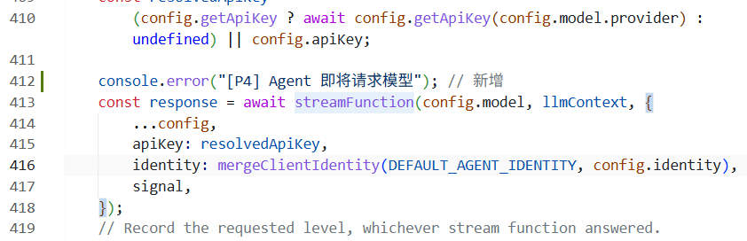
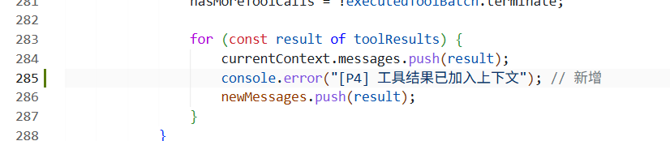
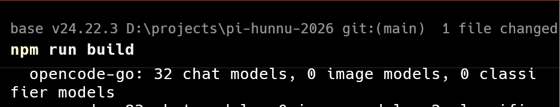
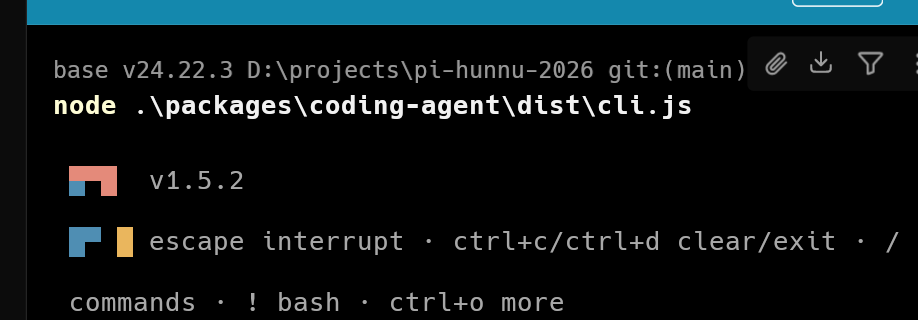
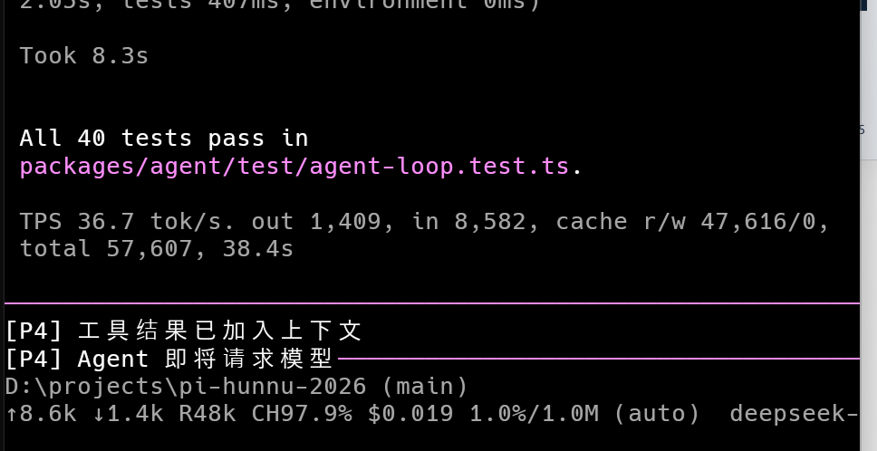

# 实践课 4：Pi Agent 的模型调用与运行流程

在实践课 3 已构建的 Pi 项目中，加两行日志并重新编译。通过对比直接问答和读取文件，观察 Pi 什么时候请求模型，以及工具结果如何进入下一轮对话。

## 任务一：给 Agent 循环加两行日志

打开 `packages/agent/src/agent-loop.ts`。以下是教师演示版本的**修改前行号**。如果小组版本的行号不同，请搜索对应语句。可以先改靠后的第 412 行，再改第 284 行。

### 1. 在模型调用前打印日志

找到原第 412 行的 `const response = await streamFunction(...)`，在它**上方**插入一行。下方展示调用的开头，保留原有参数和后续代码。

```ts
console.error("[P4] Agent 即将请求模型"); // 新增
const response = await streamFunction(config.model, llmContext, {
```

每次执行到这里，Agent 都准备把当前上下文交给模型调用函数。



**截图要求 S1：**  显示编辑器中的 agent-loop.ts 文件名、行号，以及新增的 [P4] Agent 即将请求模型 日志。画面中应同时看到日志下方的 await streamFunction(...)。

### 2. 在工具结果加入上下文后打印日志

找到原第 284 行的 `currentContext.messages.push(result);`，在它**下方**插入一行。日志写在 `for` 循环内，每写入一条工具结果就打印一次。

```ts
for (const result of toolResults) {
    currentContext.messages.push(result);
    console.error("[P4] 工具结果已加入上下文"); // 新增
    newMessages.push(result);
}
```



**截图要求 S2：**  显示 agent-loop.ts 中的 for 循环、`currentContext.messages.push(result)` 和紧接着新增的 [P4] 工具结果已加入上下文 日志。

## 任务二：重新编译并启动

保存源码。在有根目录 `package.json` 的项目目录中执行：

```powershell
npm run build
```



**截图要求 S3：**  显示项目根目录中的 npm run build 命令、构建结束后返回命令提示符，以及紧接着运行 $LASTEXITCODE 得到的 0。输出过长时可分两张截图，分别标为 S3a 和 S3b。

等构建结束且成功返回后，直接启动编译产物：

```powershell
node .\packages\coding-agent\dist\cli.js
```


两行 `[P4]` 日志会写到终端，可能和 Pi 的交互界面混在一起。运行时留意终端输出，记录出现的顺序。



**截图要求 S4：**  显示执行 node .\packages\coding-agent\dist\cli.js 的命令和成功打开的 Pi 交互界面。

## 任务三：对比两次运行

在项目根目录创建 `practice4.txt`，写入一行自定实验代号。使用同一模型，分别在两个新会话中输入以下指令。第二条指令只给文件名，把代号留在文件里。

| 会话 | 输入给 Pi 的指令 | 观察内容 |
| --- | --- | --- |
| A：直接问答 | 请直接用一句话解释什么是 Git 分支。 | 是否执行了工具，出现了几条“即将请求模型”日志 |
| B：读取文件 | 请用 `read` 工具读取当前目录的 `practice4.txt`，并告诉我文件中的实验代号。 | Pi 是否读到了自己的代号，两类日志按什么顺序出现 |

如果会话 B 只读取一次文件，随后模型直接回答，典型的完整日志顺序如下：

```text
[P4] Agent 即将请求模型
[P4] 工具结果已加入上下文
[P4] Agent 即将请求模型
```

实际次数按自己的运行记录填写。截图里的“工具结果已加入上下文”和紧接着的“Agent 即将请求模型”，展示了循环的后半段。第一类日志记录 Agent 到达一轮模型调用的位置，第二类日志记录一条工具结果写入上下文。

**截图要求 S5：**  显示会话 A 的输入指令、Pi 最终回复和实际出现的 [P4] 日志。结合日志记录是否调用了工具，以及进入了几轮模型调用。

**截图要求 S6：**  显示会话 B 的输入指令、`read` 工具读取 practice4.txt 的记录、Pi 返回的实验代号，以及实际出现的两类 [P4] 日志。终端一屏放不下时，可按发生顺序提交 S6a、S6b 等截图，并在报告中按顺序抄录日志。

## 作业提交

在个人作业仓库提交一份 `practice-04.md`，包含以下内容：

1. **源码修改。** 提交两处日志的代码差异或截图，标清插入位置。
2. **运行证据。** 提交重新编译和启动的记录，以及两次会话实际观察到的 `[P4]` 日志和结果。截图中隐去授权信息。
3. **运行流程。** 对比两次会话。 提交 A（直接问答）和 B（读取文件）的实际记录。每次写明输入指令、是否调用工具、按出现顺序记录的 [P4] 日志，以及最终回复。说明两次分别进入了几轮模型调用，并结合 B 的日志回答：谁实际读了文件？下一轮模型请求多带了什么？附一张简图标出 coding-agent、`agent`、`ai` 和远程模型服务。

在[课程作业仓库](https://github.com/hunnuOpenSourceSoftware2026/assignments/issues)提交 Issue，标题用 `实践课4：Pi Agent模型调用与运行流程 [姓名拼音]`，正文附个人报告链接和小组代码仓库链接。

